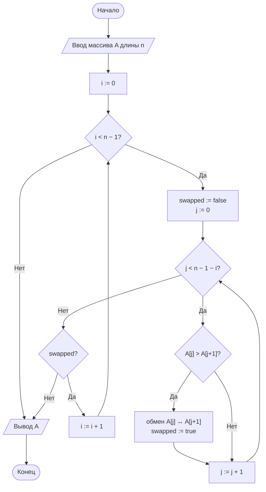
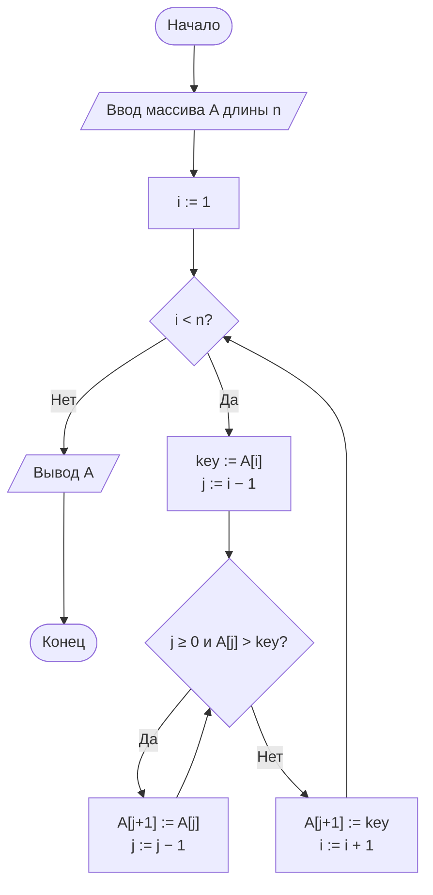
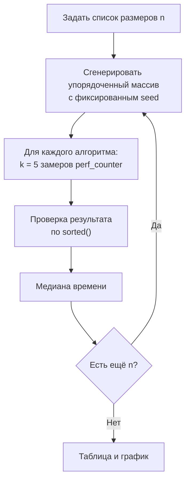

# Лабораторная работа № 2. Вариант 13

**Эмпирический анализ временной сложности алгоритмов сортировки. Часть 1: квадратичные алгоритмы (сортировка обменом и сортировка вставками)**

| | |
|---|---|
| **Дисциплина** | Теория алгоритмов |
| **Направление** | 38.03.05 «Бизнес-информатика» |
| **Выполнила** | Кугушева Арина Вячеславовна |
| **Группа** | БИ 2-1 |
| **Вариант** | 13 |
| **Язык** | Python 3.10+ (`time`, `random`, `statistics`, `matplotlib`) |

## Файлы работы

| Файл | Назначение |
|---|---|
| [`otchet_lr2_variant13.pdf`](otchet_lr2_variant13.pdf) | Отчёт (титульный лист, теория, блок-схемы, листинг, система, таблицы, график, отношения, выводы) |
| [`README.md`](README.md) | Описание работы (этот файл) |
| [`lr2_variant13.py`](lr2_variant13.py) | Программа (генерация данных, алгоритмы, замер времени, график) |

## Запуск

```bash
pip install matplotlib
python lr2_variant13.py          # график сохраняется в lr2_plot.png
python lr2_variant13.py --show   # дополнительно открыть окно с графиком
```

Программа сама выводит характеристики системы, все таблицы и сохраняет график `lr2_plot.png` (он же приведён в PDF-отчёте). Полный прогон занимает около 15 секунд.

## 1. Задание варианта 13

| Размеры массива n | Тип данных | Диапазон | Повторов k | Доп. задание |
|---|---|---|---|---|
| 1000, 2000, 3000, 4000, 5000 | S — упорядоченные | [0; 1000] | 5 | М1 |

- Сравнить время сортировки пузырьком (с флагом досрочного выхода) и сортировки вставками на упорядоченных массивах; результат замера — медиана из k = 5 повторов.
- **М1:** подсчитать число сравнений и обменов (сдвигов) для каждого алгоритма, проверить соотношения ≈ n²/2 и ≈ n²/4.
- Так как на упорядоченных данных (лучший случай) операций всего O(n), соотношения n²/2 и n²/4 проверены дополнительно на **случайных** массивах тех же размеров. Время на случайных данных измерено для сравнения с квадратичным ростом.

## 2. Теоретические оценки

| Алгоритм | Лучший случай | Средний случай | Худший случай | Доп. память | Устойчивость |
|---|---|---|---|---|---|
| Пузырьком (с флагом) | Θ(n) | Θ(n²) | Θ(n²) | O(1) | Да |
| Вставками | Θ(n) | Θ(n²) | Θ(n²) | O(1) | Да |

На упорядоченных данных ожидается T(2n)/T(n) ≈ 2, на случайных — ≈ 4.

## 3. Блок-схемы

### Сортировка пузырьком



### Сортировка вставками



### Экспериментальный стенд



## 4. Условия эксперимента

Процессор: Intel(R) Xeon(R) Processor @ 2.30GHz (2 логических ядра), ОЗУ 8 ГБ, Linux (Ubuntu 24.04), Python 3.13.18, таймер `time.perf_counter()`. Абсолютные значения на другом компьютере будут отличаться, соотношения должны сохраниться.

## 5. Результаты

**Таблица 1. Медианное время сортировки упорядоченных массивов (S), мс**

| n | Пузырьком | Вставками | Пузырёк / вставки |
|---:|---:|---:|---:|
| 1000 | 0,0298 | 0,0536 | 0,56 |
| 2000 | 0,0580 | 0,1128 | 0,51 |
| 3000 | 0,0888 | 0,1715 | 0,52 |
| 4000 | 0,1157 | 0,2391 | 0,48 |
| 5000 | 0,1647 | 0,2841 | 0,58 |

**Таблица 2 (М1). Сравнения и обмены (сдвиги) на упорядоченных данных**

| n | Пузырёк: сравнения | Пузырёк: обмены | Вставки: сравнения | Вставки: сдвиги |
|---:|---:|---:|---:|---:|
| 1000 | 999 | 0 | 999 | 0 |
| 2000 | 1999 | 0 | 1999 | 0 |
| 3000 | 2999 | 0 | 2999 | 0 |
| 4000 | 3999 | 0 | 3999 | 0 |
| 5000 | 4999 | 0 | 4999 | 0 |

**Таблица 3 (М1). Случайные данные: число операций / n²**

| n | Пузырёк: сравнения | Пузырёк: обмены | Вставки: сравнения | Вставки: сдвиги |
|---:|---:|---:|---:|---:|
| 1000 | 0,4994 | 0,2512 | 0,2522 | 0,2512 |
| 2000 | 0,4996 | 0,2532 | 0,2537 | 0,2532 |
| 3000 | 0,4997 | 0,2505 | 0,2508 | 0,2505 |
| 4000 | 0,4998 | 0,2451 | 0,2454 | 0,2451 |
| 5000 | 0,4999 | 0,2536 | 0,2538 | 0,2536 |
| Теория | 0,5 | 0,25 | 0,25 | 0,25 |

**Таблица 4. Для сравнения: медианное время сортировки случайных массивов, с**

| n | Пузырьком | Вставками | Пузырёк / вставки |
|---:|---:|---:|---:|
| 1000 | 0,0270 | 0,0122 | 2,22 |
| 2000 | 0,1033 | 0,0509 | 2,03 |
| 3000 | 0,2334 | 0,1123 | 2,08 |
| 4000 | 0,4705 | 0,2149 | 2,19 |
| 5000 | 0,7119 | 0,3212 | 2,22 |

### Отношения T(2n)/T(n)

| Переход | Данные | Пузырьком | Вставками | Теория |
|---|---|---:|---:|---|
| 1000 → 2000 | упорядоченные (S) | 1,95 | 2,10 | 2 |
| 2000 → 4000 | упорядоченные (S) | 1,99 | 2,12 | 2 |
| 1000 → 2000 | случайные (R) | 3,82 | 4,19 | 4 |
| 2000 → 4000 | случайные (R) | 4,56 | 4,22 | 4 |

### Постоянство T(n)/n (упорядоченные) и T(n)/n² (случайные)

| n | T/n, мкс — пузырёк (S) | T/n, мкс — вставки (S) | T/n², нс — пузырёк (R) | T/n², нс — вставки (R) |
|---:|---:|---:|---:|---:|
| 1000 | 0,0298 | 0,0536 | 27,01 | 12,15 |
| 2000 | 0,0290 | 0,0564 | 25,82 | 12,73 |
| 3000 | 0,0296 | 0,0572 | 25,93 | 12,48 |
| 4000 | 0,0289 | 0,0598 | 29,41 | 13,43 |
| 5000 | 0,0329 | 0,0568 | 28,48 | 12,85 |

## 6. Выводы

1. **Упорядоченные данные — лучший случай.** Оба алгоритма делают ровно n − 1 сравнений и 0 обменов (сдвигов), то есть работают за Θ(n). При удвоении n время растёт в 1,95–2,12 раза (теория: 2, а не 4), T(n)/n почти постоянно.
2. **На упорядоченных данных пузырёк быстрее вставок** в 1,7–2 раза при одинаковом числе сравнений: сортировка вставками на каждом шаге делает дополнительные присваивания (`key`, `j`, `a[j + 1] = key`) и запускает цикл `while`. Асимптотика этого не отражает — отличается константа.
3. **Соотношения М1 (случайные данные).** Пузырёк: ≈ 0,5·n² сравнений и ≈ 0,25·n² обменов; вставки: ≈ 0,25·n² сравнений и ≈ 0,25·n² сдвигов. Число обменов пузырька и сдвигов вставок равно числу инверсий n(n − 1)/4.
4. **Квадратичный рост на случайных данных.** T(n)/n² почти постоянно, T(2n)/T(n) = 3,82–4,56 при теории 4 → средний случай Θ(n²). Вставки быстрее пузырька в 2,0–2,2 раза: вдвое меньше сравнений и более дешёвый сдвиг, чем обмен.
5. **Применимость.** Алгоритмы годятся для небольших и почти упорядоченных массивов. 5000 случайных элементов — 0,3–0,7 с; экстраполяция на 100 000 элементов (×400) даёт ≈ 2 мин (вставки) и ≈ 5 мин (пузырёк), поэтому для больших данных нужны алгоритмы O(n log n).

## 7. Литература

1. Кормен Т., Лейзерсон Ч., Ривест Р., Штайн К. Алгоритмы: построение и анализ. — 3-е изд. — М.: Вильямс, 2013. — Гл. 2, 3.
2. Кнут Д. Э. Искусство программирования. Т. 3. Сортировка и поиск. — 2-е изд. — М.: Вильямс, 2017.
3. Седжвик Р., Уэйн К. Алгоритмы на Java. — 4-е изд. — М.: Вильямс, 2013. — Гл. 2.
4. Скиена С. Алгоритмы. Руководство по разработке. — 3-е изд. — СПб.: БХВ-Петербург, 2022.
5. Документация Python: модуль `time`. — https://docs.python.org/3/library/time.html
